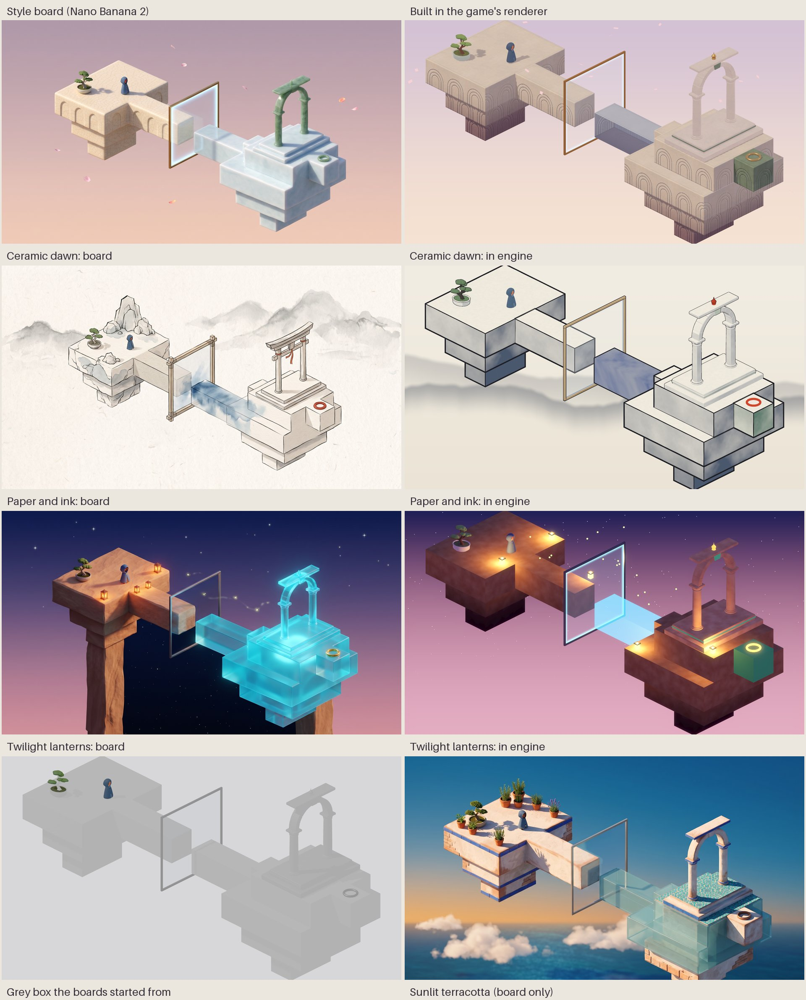

# Look pilot: how far lighting and materials carry

Written 2026-10-27. The art pipeline research ([art-pipeline.md](art-pipeline.md))
found that geometry is not the gap; lighting, materials and composition are.
This pilot tests that, and gives the owner style boards to choose an art
direction from. Nothing here is agreed; `GAME_DESIGN.md` records only agreed
decisions.

## What was done

1. **A grey-box diorama in the game project** (`art_trial/look_pilot/`). It
   has a start terrace with the traveller and the bonsai, a path, the mirror
   and its copy across the gap, and a goal terrace with the pilot's gate and
   the jade goal. It is rendered with the game's orthographic camera from all
   four views, in the Mobile renderer.
2. **Four style boards from Nano Banana 2** (`gemini-3.1-flash-image`). Each
   restyles the same grey-box render, so the layout and camera stay fixed:
   ceramic dawn, paper and ink, sunlit terracotta, and twilight lanterns.
   The prompts are in `art_trial/look_pilot/boards/`.
3. **Three looks built in the engine** from the boards: ceramic (the current
   identity), ink and twilight. Terracotta stays a board, because its look
   rests on detailed textures and many props.

*Left: the board. Right: the same diorama in the game's renderer. The
bottom row shows the grey box the boards started from, and the terracotta
board. Four-view sheets: [ceramic](look-pilot/engine-ceramic-views.jpg),
[ink](look-pilot/engine-ink-views.jpg),
[twilight](look-pilot/engine-twilight-views.jpg).*

## Round 2: eight more boards

Eight more concepts from the same grey box, on a revised prompt
(`boards/common_v2.txt`) that says only the one path block is the copy. In
all eight the copy now stays on that block, distinct from the originals,
and the goal block stands apart. The two rounds and the in-engine looks
share [one canvas](look-pilot/concepts-canvas-2026-10.jpg).

| Concept | The copy | The goal |
| --- | --- | --- |
| Papercraft | vellum tracing paper (faint) | gold foil card |
| Clay miniature | pale-blue resin | green glazed clay |
| Risograph print | coral hatching | dark overprint |
| Overgrown garden | the path in full spring bloom | bronze with patina |
| Winter town | clear blue ice | red lacquer |
| Wooden toy blocks | coloured acrylic | painted star block |
| Ligne claire comic | flat cobalt with highlight lines | magenta |
| Tide pool and sea glass | frosted aqua sea glass | mother-of-pearl |

The garden board makes the story literal: the copy is the same path from a
life where the town was never left. The board cost is about $0.80 at list
price.

## What it showed

- **Lighting and palette move the look furthest for the least work.** The
  same blocks read as three different games. Every effect used is supported
  by the Mobile renderer: point lights, emission, glow, unlit shading, a
  backdrop and transparency.
- **Twilight comes closest to its board.** Lanterns as real point lights,
  a glowing cyan copy, a gold goal and a starry gradient carry it. It falls
  short on surface detail (the sandstone is muddy) and on silhouette: the
  board stands the islands on rock pillars.
- **Ink is recognisable from shaders alone.** It uses unlit paper with
  banded washes, ink on every block edge, the copy brushed in blue ink and
  wash mountains behind. It lacks the board's paper grain, varied line
  weight and props such as rocks. Lines on the gate and the bonsai are thin
  and uneven, because they come from a different technique than the blocks.
- **Ceramic is furthest from its board.** The game's block shader gives the
  carvings, but the board's richness comes from crackle detail, soft
  contact shadows and a strong warm–cool contrast. In the engine the
  contrast is low and the copy reads grey-blue rather than luminous
  porcelain. Closing that needs baked lighting (LightmapGI, which bakes in
  the editor), crackle in the shader and a brighter, cooler porcelain.
- **Two cheap techniques mattered in every look.**
  - **A screen-space backdrop.** An orthographic camera sees the sky as one
    flat colour, so the gradient, stars and mountains are drawn per pixel.
  - **An underside shade** that darkens blocks toward their base. It is what
    makes the islands read as floating.
- **The boards outrun the engine on props and detail.** Rocks, lanterns,
  pillars, plants and fine surface texture come free in a board. In the
  engine each is asset work: the kit from the art pipeline.
- **Boards are mood references, not specifications.**
  - Two boards turned the whole goal island into mirror glass, which would
    hide the difference between original and copy.
  - The ink board turned the gate into a torii.

  Each look must keep originals, copies and jade distinct. Ink and twilight
  do; the ceramic copy is the weakest.

## Measurements

| | Ceramic | Ink | Twilight |
| --- | --- | --- | --- |
| Rendered rounds to this state | 4 | 2 | 2 |
| New shaders | underside shade, backdrop, glass | surface, outline, wash, backdrop | backdrop, glass, underside shade |
| Uses the game's own block shaders | yes | no | no |

- **Board cost:** four images at 2K, about $0.40 at Google's list price.
- **Time:** the container's file timestamps put the build, from the first
  model to the comparison sheet, at about 12 minutes. Treat that as
  approximate.
- **Token usage:** not available.

## Ideas this raises

- **Light as the chapter signature.** A time of day per chapter, from dawn
  to twilight, is the cheapest strong variation, and it can follow the
  story.
- **The other life in another medium.** In a story about possible lives,
  the mirror's copy could render in a different look from the original,
  such as ink copies in a ceramic world. It would make the mechanic and the
  theme the same picture. It needs a design pass before anyone builds it.

## Next steps

These need the owner's choice of direction first.

1. **Choose one or two directions,** or ask for another board round. Boards
   are cheap.
2. **Apply the chosen look to a real tutorial stage**, with baked lighting
   on the Mac.
3. **Add the props that the boards rely on** as kit pieces in Blender
   scripts (lanterns, rocks, pillars, plants), following the art pipeline.
4. **Optionally, generate organic props** such as rocks and statues with
   Tripo or Meshy, whose keys are now available.

## Limits

- **Software rendering:** captures used Linux software Vulkan, not a Mac
  with Metal.
- **No baked lighting:** LightmapGI bakes only in the editor.
- **Small scope:** one diorama, still frames only (the petals and
  fireflies do not move), and each look got a few rounds from one agent.
