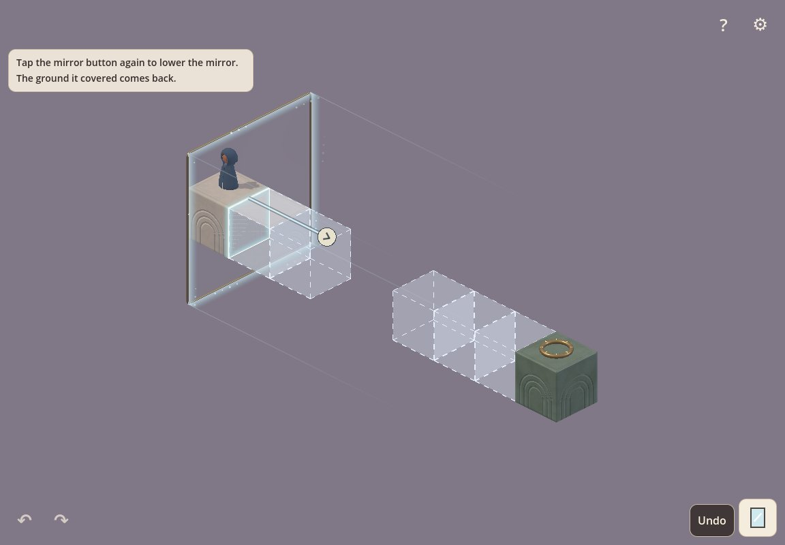
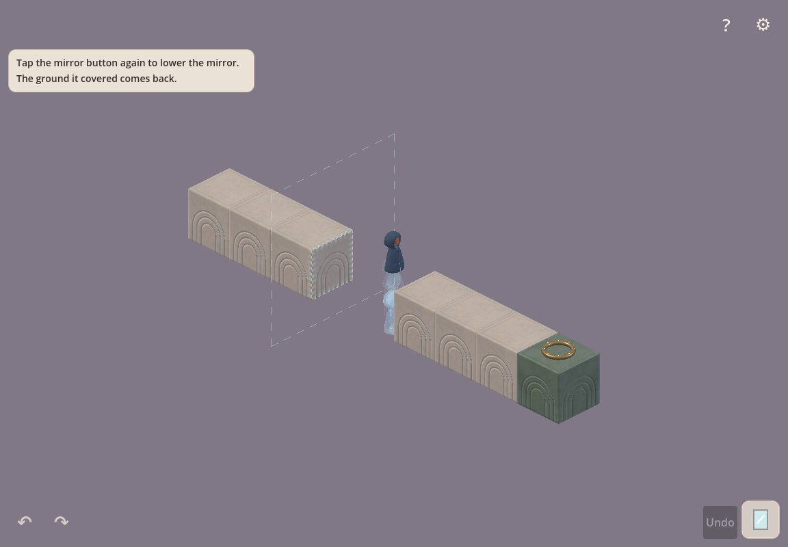
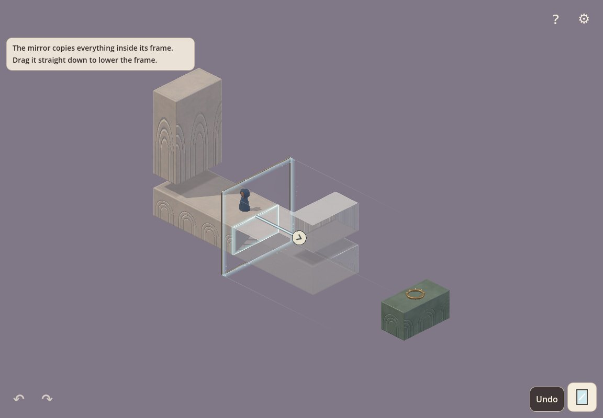
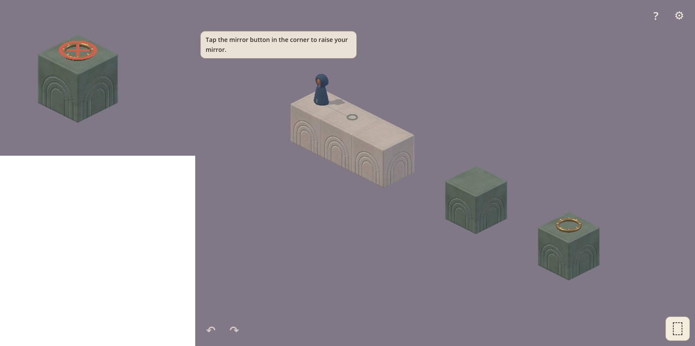

# Playtest fixes: the plan

Written 2026-10-29. The owner agreed that every point in the
[agent playtest](playtests/2026-10-agent-playtest.md) is valid: fix the most
important first, then all of them in order. Each item names the playtest
section it comes from. Mark items done here as they land.

## Order

Ranked by how much each one cost the player: a stage that does not finish,
then deaths the player could not foresee, then time lost reading the
space, then wording and polish.

| # | Fix | Playtest | Status |
| --- | --- | --- | --- |
| 1 | **The goal counts on its whole tile.** A walk that ends anywhere on the goal's tile ends on the goal. | 4.1 | done |
| 2 | **Show what a raised mirror hides.** Draw the replaced originals as a faint outline while the mirror is up, and give the mirror button the fall ghost a drag already has, before it lowers or raises. | 4.2 | done |
| 3 | **Don't apply a predicted fall off the world from the arrow or a drag.** Keep the preview on release and ask for a second release, or bounce it back as a blocked change does. Check that turning the mirror keeps the traveller on the source side where it can. | 4.5 | done |
| 4 | **A clear failure state.** Show that the traveller fell, pulse Undo, or rewind after a moment. Today the traveller hangs in the void. | 4.6 | done |
| 5 | **Make positions readable.** Contact shadows under copies; a "can't reach" cue on a failed tap; on desktop, the reachable path on hover. | 4.3 | done |
| 6 | **Forgiving half-unit steps.** More pointer travel per step, or settling to the nearest connecting position; arrow-key nudges for the mirror on desktop. Size it for phones too. | 4.4 | done |
| 7 | **Prompts.** Stage 1 on desktop names the arrows and Q/E, not a swipe; stage 3 drops "again" before the mirror is up; stage 4 shows the problem before the hint; stage 5 gets a visual cue instead of text. | 4.7 | done |
| 8 | **Small fixes.** Camera buttons that don't look like Undo and Redo; a visible grab area and hover cue for the mirror; no mirror button on stage 1; a Reset in the release UI; a larger stage on phone layouts. | 3, 4.8 | done |

Items 2 to 4 share one idea: the player sees an outcome before it
happens, and can always recover from it. Build them together if that
proves simpler.

## How each fix is checked

- A focused headless test for the changed behaviour, like
  `tests/goal_tests.gd` for item 1.
- The suites that touch it, once: `prompt_tests`,
  `level_solvability_tests -- --direct-only`, `app_flow_tests` and
  `direct_controls_tests`.
- After items 2 to 6, a second agent playtest that has not seen
  `tests/tutorial_playthrough.gd`, and then a person on a Mac.

## Done

1. **The goal counts on its whole tile** (`game.gd`, `request_walk`). The
   stage completes when the traveller is within 0.22 of the goal, but a
   walk ended at the exact tapped point, so an off-centre tap on the goal
   tile left the traveller standing on it with nothing happening.
   `tests/goal_tests.gd` reproduced it (stopped 0.46 from the goal) and now
   passes.

2. **The ground a raised mirror hides is outlined** (`core/display_geometry.gd`
   and `core/world_geometry.gd` `hidden`, `world/world_view.gd`
   `draw_hidden`). While a mirror is up, or previewed, the parts of
   originals in its destination column show as a faint fill with dashed
   edges, drawn slightly inside each block. Absolutes are never hidden, so
   they are left out.
   
3. **A mirror change that would drop the traveller off the world is
   refused** (`game.gd` `_refuse_fall`). This covers a drag, the arrow and
   the mirror button alike. The preview stays for 1.2 s, so the ghost shows
   the fall, then the mirror goes back and nothing enters the history. Safe
   falls onto ground below still apply, so stage 6's landing is unchanged.
   This also gives the mirror button its fall preview where it matters.
   
   The design changes here: in the direct controls a mirror change can no
   longer kill the traveller. The classic editor is unchanged.
4. **A fall rewinds itself.** With the direct controls, a fall off the
   world shows "The traveller fell off the world. Going back." and undoes
   the last action after a second. After item 3 a mirror change can no
   longer cause one, so this is a safety net.
   The hint is dropped while a lesson prompt is on screen, as every hint
   is; the ghost and the mirror going back carry the message.
5. **Positions are easier to read** (`world/world_view.gd`,
   `world/drop_shadow.gdshader`, `game.gd`).
   - Every floating block, copy or original, casts a soft shadow straight
     down onto each surface under it, fainter the higher it floats. A block
     that rests on another casts none. In a fixed isometric view this is
     what tells "above the path" from "beside it".
   - A tap on a place the traveller cannot reach shows a red ring and cross
     there for about a second. The hint text was already there, but it is
     dropped while a lesson prompt shows.
   - On desktop, hovering shows the way the traveller would walk, faintly.
     A place with no way to it shows nothing.

   `tests/readability_tests.gd` covers all three (11 checks).
   
   
6. **Half-unit steps are easier to hit** (`game.gd` `_screen_axes`,
   `_nudge_key`, `nudge_mirror`).
   - A half step always takes at least 40 logical units of drag. At
     1152×800 that was about 30; in phone portrait about 12. Where the stage
     is drawn small, the mirror now moves slower than the finger.
   - On desktop, the arrow keys nudge a raised mirror by half a unit: Up
     and Down along the ground axis that runs up and to the right on
     screen, Left and Right along the other. Page Up and Page Down lift and
     lower it. Each nudge is one Undo step, goes through the same preview,
     and is refused like a drag if it would drop the traveller off the
     world. The keys work in the release build.
   - Not done: settling to the nearest position that connects to
     something. It would choose for the player, and the drop shadows and
     the hover path may make it unnecessary. Revisit after the next
     playtest.

   `tests/step_tests.gd` covers both (20 checks). Three test helpers that
   turned world units into screen drags now use `_screen_axes`.
7. **The prompts fit what the player has seen** (`game.gd` `_prompt_ready`,
   `core/level_loader.gd`, `ui/world_gesture.gd`, three stage files).
   - Stage 1: a mouse drag sideways on empty space now turns the view, as a
     touch swipe does, and the prompt says "Drag sideways, or use the arrows
     in the corner".
   - Prompts can wait, hidden, for an `after` event. Stage 3's prompt waits
     until the mirror is up and now reads "Lowering the mirror brings back
     the ground it covered. Tap the mirror button to lower it." Stage 4's
     waits for a walk that cannot get through (a new `no_path` event), so
     the player meets the copied tower before the hint names the answer.
     Its action still closes a prompt while it waits, and the "?" replay
     shows every prompt.
   - Stage 5 keeps its text. Its real difficulty was reading positions; the
     drop shadows from item 5 are its visual cue. Judge it in the next
     playtest.

   `tests/prompt_tests.gd` covers the waiting, the new event and the mouse
   drag (82 checks). The full classic suite, `tests/run_tests.gd`, passed
   once after the gesture change (594 checks).
8. **Small fixes** (`ui/mirror_hud.gd`, `game.gd`, `world/mirror_sheet.gd`,
   `world/mirror_frame.gd`, `world/stage_camera.gd`, `core/level_loader.gd`,
   stage 1's file). Pictures:
   [grab and camera buttons](playtests/2026-10-fixes/grab-hover-and-camera-icons.jpg),
   [phone framing](playtests/2026-10-fixes/phone-framing.jpg).
   - The camera buttons are drawn as one bold, flattened orbit arrow with
     its head at the front, pointing the way of the turn, not as the ↶ ↷
     glyphs. Tooltips: "Turn left (Q)", "Turn right (E)".
   - The mirror takes a press anywhere on its panel, through a block that
     passes through the frame, and up to a quarter unit past the glass. A tap
     there still walks. On desktop, the pointer on the mirror shows a move
     cursor, the frame glows and the glass brightens; on the arrow's knob it
     shows a hand.
   - A stage can set `"mirror_available": false`. Stage 1 does: no mirror
     button, and M does nothing.
   - The release settings panel has **Restart stage** above Return to
     title. It closes the panel and reloads the stage.
   - Phone framing. On a short landscape screen (play height under 560 px
     and wider than 1.3 × its height), the stage takes the full height
     between two equal side columns that hold the corner controls; Undo
     counts while hidden, so its first appearance does not move the view.
     A narrow portrait screen lets the stage use the full width. A small
     screen keeps a smaller fit margin (8 % of the shorter side, at most
     48 px, so desktop is unchanged). At 844×390 the "A place to stand"
     stage grew from 225×140 px to 373×232 px; at 390×844 from 262 to
     300 px wide.

   `tests/small_fix_tests.gd` covers all five (56 checks). The rule check in
   `direct_controls_tests` that turned the mirror on stage 1 now turns the
   mirror back on for itself first.
